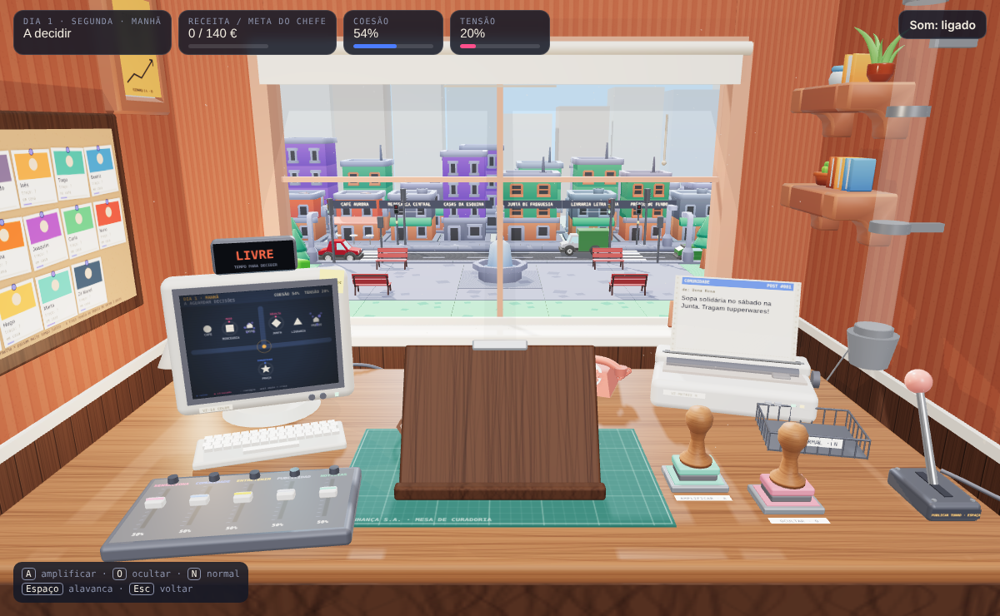
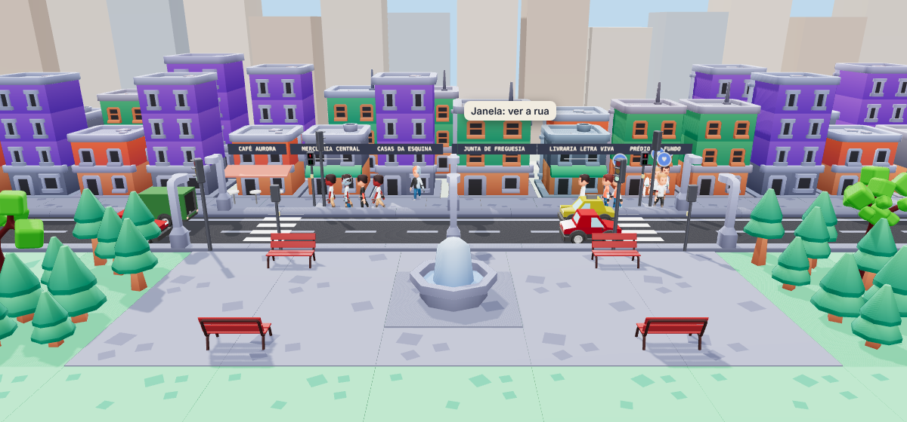
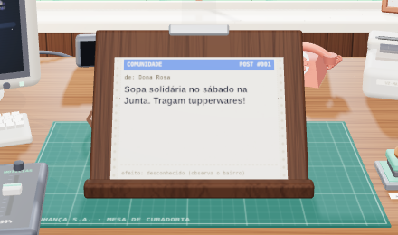
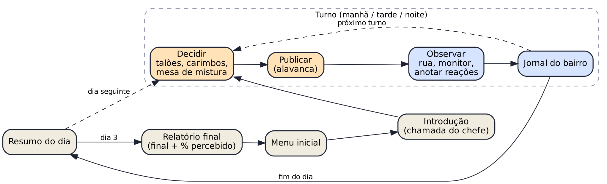
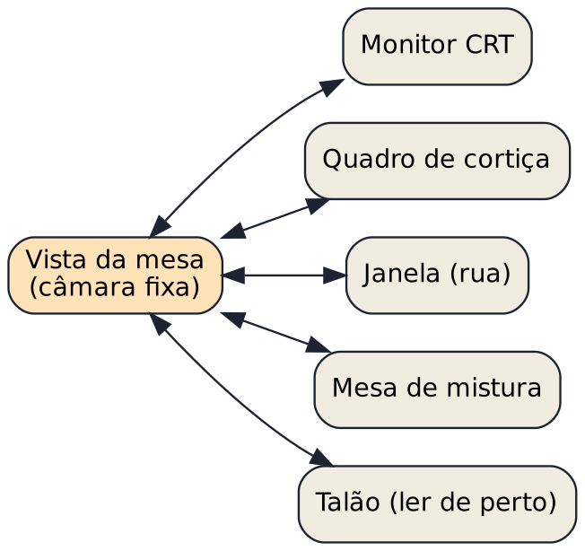

# Echo Chamber

D1. Scope document (DESDJ)

[Team members' names and numbers]

Outubro de 2026, versão 1.1

## Overview of Concept

Echo Chamber é um jogo 3D de simulação e estratégia para PC em que o jogador é o algoritmo da "Vizinhança", a rede social de um bairro do Porto, e decide a partir de uma sala de controlo que publicações são amplificadas ou ocultadas. O objetivo é cumprir as metas de receita impostas pela empresa sem destruir o bairro, o que só é possível aprendendo, pela observação, como os vizinhos se influenciam uns aos outros.

**Enquadramento no tema.** O sistema invisível do jogo é o próprio bairro: a rede de crenças, medos e confiança entre os vizinhos. O jogador nunca vê esse sistema diretamente. Vê apenas o que as pessoas fazem, pela janela e pelo monitor, e tem de deduzir as regras que estão por trás. Esse sistema pode ser explorado, falha de forma visível (lojas que fecham, protestos, pânico) e torna-se aliado ou obstáculo consoante o que o jogador consegue perceber dele. A descoberta é a própria mecânica central: o jogo mede quanto do bairro o jogador percebeu.

### Key features

- Sala de controlo diegética: a interface são objetos físicos (impressora de posts, carimbos, mesa de mistura, monitor CRT, quadro de cortiça, telefone, alavanca).

- Ciclo por turnos de decidir, publicar e observar, com consequências visíveis na rua.

- Bairro simulado por agentes com IA baseada em utilidade e contágio social entre vizinhos.

- Descoberta como mecânica: o jogador anota reações e constrói o seu próprio mapa do bairro.

- Tensão constante entre lucro (visível) e impacto social (escondido).

- Vários finais conforme o estado do bairro e o que o jogador conseguiu perceber.

## Description

**Género e público.** Simulação e estratégia narrativa, com elementos de puzzle de observação, na linha de Papers, Please e Headliner: NoviNews. Pensado para jovens adultos e adultos que gostam de jogos sistémicos e com peso ético, e para quem tem curiosidade sobre o funcionamento das redes sociais. Sessões curtas, de cerca de 10 a 15 minutos.

**História.** O jogador é contratado pela Vizinhança S.A. e trabalha numa cave por baixo do café do bairro, onde funciona "o algoritmo". Ninguém o vê, mas tudo o que 14 vizinhos sabem do bairro passa pela sua mesa. O chefe, o Dr. Valente, telefona todos os dias com uma meta de receita. Ao longo de três dias, o bairro atravessa situações cada vez mais delicadas, como a possível falência da livraria local, boatos sobre assaltos e o interesse de um fundo imobiliário na praça. O desfecho depende do que o jogador decidiu publicar e do quanto percebeu das pessoas.

**Aspeto e ambiente.** Low-poly estilizado com cores quentes. A cave é acolhedora e um pouco claustrofóbica, cheia de tecnologia retro (CRT, impressora matricial, telefone de disco), em contraste com a app moderna que opera. A janela dá para a rua e para a praça do bairro, que mudam com a hora do dia e com o estado das pessoas.

**O que o jogador faz.** Depois de carregar em "Começar", o telefone toca e o chefe dá a meta do dia. A impressora começa a imprimir posts dos vizinhos, um de cada vez. O jogador lê cada talão e decide: carimba AMPLIFICAR, carimba OCULTAR ou deixa passar normalmente. Pode também ajustar na mesa de mistura o peso de cada categoria de conteúdo. Quando termina, puxa a alavanca e o turno é publicado. Durante a simulação já não pode decidir. Observa pela janela e no monitor como os vizinhos reagem e anota essas reações. No fim de cada turno, o jornal do bairro relata o que aconteceu, mas não explica porquê.

**Progressão.** Três dias com três turnos cada (manhã, tarde e noite). Cada dia traz mais posts, metas mais altas e situações mais sensíveis. O conhecimento acumulado no quadro de cortiça (quem é quem, quem anda com quem, que conteúdos provocam o quê) é o que permite ao jogador decidir melhor à medida que a pressão aumenta.

**Personagens.** O jogador não tem rosto: é o operador do algoritmo. As personagens são os 14 vizinhos, cada um com uma personalidade escondida (por exemplo, mais ansioso, mais cético ou mais consumista) que o jogador vai descobrindo, e o Dr. Valente, que representa a pressão comercial da empresa.

### Estados dos vizinhos

Cada vizinho tem seis estados internos entre 0 e 1, que o jogador nunca vê. Os valores iniciais são sorteados dentro de um intervalo e vão ser calibrados.

| **Estado**          | **Valor inicial**   | **Repouso** | **Comportamento**                                                                                       |
|---------------------|---------------------|-------------|---------------------------------------------------------------------------------------------------------|
| Stress              | 0,16 a 0,30         | 0,22        | Sobe com medo e alarmes. Acima de 0,68 o vizinho anda mais depressa. Desce na praça, em casa e no café. |
| Pertença            | 0,42 a 0,62         | sem repouso | Sobe com conteúdo de comunidade, no café e na praça.                                                    |
| Desconfiança        | 0,08 a 0,22         | 0,13        | Sobe com boatos e na Junta. Leva ao protesto.                                                           |
| Apatia              | 0,12 a 0,28         | 0,20        | Sobe com entretenimento e ao ecrã. Leva a ficar no telemóvel.                                           |
| Vontade de consumir | 0,20 a 0,60         | sem repouso | Sobe com publicidade e desce após uma ida às compras.                                                   |
| Afeto pela livraria | 0,10 (leitor: 0,50) | mínimo 0,05 | Sobe com posts sobre a livraria. Decide a ida à livraria.                                               |

Os estados regressam lentamente ao repouso (cerca de 0,4% a 0,8% por segundo) e, no fim de cada dia, aproximam-se dele mais um pouco. Vizinhos no mesmo local aproximam os seus estados a um ritmo de 3,5% da diferença por segundo, o que espalha o medo ou a calma sem passar pela app. Em cada momento o vizinho escolhe a ação com maior utilidade, calculada como uma soma ponderada destes estados.

### Métricas e condições de vitória

O jogador vê dois indicadores agregados, calculados com a média dos 14 vizinhos: **tensão** = 0,65 × stress + 0,35 × desconfiança (mais 12 pontos durante um motim) e **coesão** = 1,25 × pertença × (1 − 0,6 × desconfiança) − 0,2 × apatia. Com tensão acima de 62% a polícia patrulha a rua, e acima de 70% os anunciantes pagam metade. Os objetivos de cada dia são:

| **Dia**     | **Objetivo verificável**                                         |
|-------------|------------------------------------------------------------------|
| 1 · Segunda | Receita ≥ 140 € e tensão < 70% no fecho do dia                  |
| 2 · Quarta  | Receita ≥ 220 €, livraria aberta e tensão < 70% no fecho do dia |
| 3 · Sábado  | Receita ≥ 260 € e tensão < 70% no fecho do dia                  |

No fim do dia 3 o final é o primeiro cuja condição se verifica, por esta ordem:

| **Final**                     | **Condição**                             | **Leitura**     |
|-------------------------------|------------------------------------------|-----------------|
| 1. Bairro adormecido         | Apatia média > 55%                      | Falha           |
| 2. Bairro trancado           | Tensão > 65%                            | Falha           |
| 3. Bairro vivo, app em perda | Coesão ≥ 55% e receita do dia 3 < 260 € | Vitória parcial |
| 4. Equilíbrio raro           | Coesão ≥ 50%                             | Vitória         |
| 5. Gentrificação silenciosa  | Nenhuma das anteriores                   | Falha suave     |

O relatório final mostra também o "Bairro percebido": (vizinhos com personalidade descoberta + relações descobertas, até 8) a dividir por 22. Não condiciona o final, mas mede quanto do sistema invisível o jogador descobriu.

## Technical Specification

- Motor: Unity (versão LTS a definir), com Universal Render Pipeline.

- Linguagem: C#. Controlo de versões com Git (com LFS para assets).

- Plataforma alvo: PC (Windows e macOS). Controlo por rato e teclado.

- Single-player. Não está previsto multiplayer.

- Feature avançada: inteligência artificial dos vizinhos (decisão baseada em utilidade e contágio social), apresentada ao jogador através de visualização de dados (monitor, quadro de cortiça e relatório final).

- Assets 3D de licença livre (Kenney, KayKit e outros CC0), com ajustes pontuais em Blender. Áudio de bibliotecas livres ou produzido pela equipa.

- Hardware de desenvolvimento: computadores pessoais da equipa. O jogo deve correr de forma fluida num portátil comum.

- Um protótipo funcional em three.js foi usado para validar o ciclo de jogo e as regras dos vizinhos antes da implementação em Unity.

## Concept art

As imagens seguintes são do protótipo de validação e servem de referência para o aspeto pretendido. A versão final em Unity poderá ser diferente.

*Sala de controlo: monitor CRT, mesa de mistura, suporte com o talão, impressora, carimbos e alavanca.*

*Vista da janela: a rua, a praça e os vizinhos a reagir aos posts.*

*Talão de um post no suporte de leitura.*

## Interface (fluxograma)

*Fluxo de jogo: cada dia tem três turnos de decidir, publicar, observar e ler o jornal.*

*A câmara está fixa na mesa e aproxima-se dos objetos com que o jogador interage.*

## Controlos

- Rato: interagir com os objetos da sala, arrastar faders, clicar nos vizinhos para anotar reações.

- A: carimbar AMPLIFICAR. O: carimbar OCULTAR. N: enviar para o cesto NORMAL.

- Espaço: puxar a alavanca e publicar o turno. Esc: voltar à vista da mesa.

## Áudio

Sons diegéticos (impressora matricial, carimbo, alavanca, tubo pneumático, telefone, rádio do bairro) e ambiente de rua vindo da janela. Música discreta, a definir.

## Schedule and Deliverables

06/11/2025 D1.1. Scope document (version 1.0)

26/11/2025 D2.1. Game Design Document (version 0.x)

D2.2. First Prototype

18/12/2025 D3.1. Game Design Document (version 1.0)

D3.1. Final prototype

**User Stories / Functional and non-functional requirements**

First Prototype

- Como jogador, quero receber posts impressos e carimbá-los para decidir o que o bairro vê. Critério: um turno completo, do primeiro talão ao jornal, sem erros.

- Como jogador, quero puxar a alavanca e ver os 14 vizinhos reagir na rua e no monitor. Critério: pelo menos 3 ações diferentes visíveis por turno e cada post carimbado altera pelo menos um estado de um vizinho.

- Como jogador, quero ajustar o peso de cada categoria na mesa de mistura e ver a receita, a coesão e a tensão atualizarem no fim do turno.

- Requisito não funcional: um turno completo jogável de ponta a ponta, com feedback visual e sonoro nas interações principais.

Final Prototype

- Como jogador, quero anotar as reações dos vizinhos e ver o quadro de cortiça preencher-se. Critério: pelo menos 80% dos vizinhos com a personalidade descobrível, e a percentagem de bairro percebido visível no relatório.

- Como jogador, quero ler o jornal no fim de cada turno e deduzir as causas do que aconteceu, que o jornal não revela.

- Como jogador, quero jogar três dias de três turnos com metas de receita de 140, 220 e 260 euros e chegar a um de cinco finais. Critério: os finais são escolhidos por condições medidas (apatia > 55%, tensão > 65%, coesão ≥ 55% com receita abaixo da meta, coesão ≥ 50%, ou nenhuma).

- Como jogador, quero ver no relatório final quanto do bairro consegui perceber, e como a coesão e a tensão evoluíram ao longo dos três dias.

- Requisito não funcional: pelo menos 10 minutos de jogo efetivo.

- Requisito não funcional: inclui prefabs, modelos, texturas, física, iluminação, animações, áudio e UI, e a feature avançada de IA.

**References**

- Headliner: NoviNews (Unbound Creations).

- We Become What We Behold e The Evolution of Trust (Nicky Case).

- Not For Broadcast (NotGames).

- Orwell: Keeping an Eye On You (Osmotic Studios).

- Papers, Please (Lucas Pope).

- Mini Metro (Dinosaur Polo Club).

- Restory (referência visual para a sala de trabalho).

- Kenney (kenney.nl) e KayKit (Kay Lousberg): assets 3D de licença livre.

> Nota: as datas do calendário acima vêm do template da cadeira e podem não estar atualizadas.
